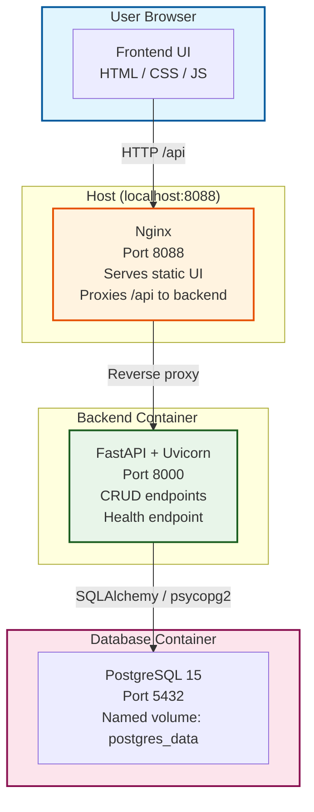

# Containerized 3-Tier Application | Docker Compose, Bash, Jenkins

A Task Management web application built with three separate tiers — frontend (Nginx + HTML/CSS/JavaScript), backend (Python + FastAPI), and database (PostgreSQL) — orchestrated with Docker Compose, automated with Bash scripts, and described by a Jenkins CI/CD pipeline.

Users can create, view, update, and delete tasks. Task data is stored permanently in PostgreSQL.

## Table of Contents

- [Project Objective](#project-objective)
- [Architecture](#architecture)
- [Technology Stack](#technology-stack)
- [Folder Structure](#folder-structure)
- [Tier Responsibilities](#tier-responsibilities)
- [Docker Compose Explanation](#docker-compose-explanation)
- [Installation Requirements](#installation-requirements)
- [Setup and Deployment Instructions](#setup-and-deployment-instructions)
- [Docker Compose Commands](#docker-compose-commands)
- [API Endpoints](#api-endpoints)
- [Configuration (.env)](#configuration-env)
- [Automated Testing](#automated-testing)
- [Seven Bash Scripts](#seven-bash-scripts)
- [GitHub Actions](#github-actions)
- [Jenkins CI/CD Pipeline](#jenkins-cicd-pipeline)
- [Troubleshooting Guide](#troubleshooting-guide)
- [Common Interview Questions and Answers](#common-interview-questions-and-answers)

## Project Objective

Build a Task Management web application with three separate tiers:

- **Frontend:** HTML, CSS, and JavaScript served using Nginx. Provides the user interface for creating, viewing, updating, and deleting tasks.
- **Backend:** Python 3 and FastAPI. Exposes a REST API for task CRUD operations and health checks.
- **Database:** PostgreSQL. Stores task information permanently.

The tiers are containerized with Docker, connected via a Docker bridge network, and orchestrated with Docker Compose. Persistent PostgreSQL data is kept in a named volume so it survives container restarts.

## Architecture



### How a request flows

1. User opens `http://localhost:8088` in a browser.
2. Nginx serves the static frontend (index.html, style.css, app.js).
3. The browser's JavaScript calls `/api/tasks` (and other `/api/*` paths).
4. Nginx reverse-proxies `/api/*` to the FastAPI backend container at `http://backend:8000`.
5. FastAPI reads/writes tasks to PostgreSQL using SQLAlchemy + psycopg2.

## Technology Stack

| Tier | Technology | Purpose |
|------|-----------|---------|
| Frontend | HTML5, CSS3, JavaScript (Vanilla) | User interface |
| Frontend server | Nginx (alpine) | Serves static files and reverse-proxies `/api` |
| Backend language | Python 3.11 | Application logic |
| Backend framework | FastAPI 0.115.0 | REST API |
| Backend server | Uvicorn 0.30.6 | ASGI server |
| Database | PostgreSQL 15 (alpine) | Persistent task storage |
| Database driver | psycopg2-binary 2.9.12 | PostgreSQL adapter for Python |
| ORM | SQLAlchemy 2.0.58 | Database abstraction |
| Validation | Pydantic V2 | Request/response schemas |
| Orchestration | Docker Compose | Multi-container setup |
| Automation | Bash scripts | start/stop/restart/health/logs/cleanup/troubleshoot |
| CI/CD | Jenkins Declarative Pipeline | Build and test pipeline |
| Testing | pytest 8.3.2 | Automated backend tests |

## Folder Structure

```
Containerized-3Tier-App/
├── .env.example                  # Example environment variables (copy to .env)
├── .gitignore                    # Git ignore rules
├── .dockerignore                 # Files excluded from Docker build context
├── Dockerfile.backend              # Backend Docker image (FastAPI, non-root user)
├── docker-compose.yml              # Multi-service orchestration (db, backend, frontend)
├── Jenkinsfile                     # Declarative Jenkins CI/CD pipeline
├── README.md                       # This file
│
├── backend/
│   ├── requirements.txt            # Python dependencies
│   └── app/
│       ├── __init__.py
│       ├── main.py                 # FastAPI entry point, mounts /api routes
│       ├── config.py               # Environment-based configuration
│       ├── database.py             # SQLAlchemy engine, session, Base, get_db()
│       ├── models.py               # Task SQLAlchemy model
│       ├── schemas.py              # Pydantic request/response schemas
│       ├── crud.py                 # Create, Read, Update, Delete operations
│       └── api/
│           ├── __init__.py
│           └── routes.py           # /api/health and /api/tasks endpoints
│
├── frontend/
│   ├── Dockerfile                  # Frontend Docker image (Nginx)
│   ├── nginx.conf                  # Nginx config: static files + /api proxy
│   ├── index.html                  # Frontend UI
│   ├── style.css                   # Frontend styles
│   └── app.js                      # Frontend JavaScript (calls /api)
│
├── scripts/
│   ├── start.sh                    # Start the application
│   ├── stop.sh                     # Stop services (keeps persistent data)
│   ├── restart.sh                  # Restart services
│   ├── health-check.sh             # Check container and API health
│   ├── collect-logs.sh             # Save timestamped logs for all services
│   ├── cleanup.sh                  # Clean up containers/resources safely
│   └── troubleshoot.sh             # Display status, logs, troubleshooting info
│
└── tests/
    ├── __init__.py
    ├── conftest.py                 # Pytest fixtures (SQLite test database)
    ├── requirements.txt            # Test dependencies (pytest, httpx)
    └── test_tasks.py               # 10 automated tests
```

## Tier Responsibilities

### Frontend (Nginx)
- Serves the static `index.html`, `style.css`, and `app.js` on container port 80.
- Exposes the UI to the host on `localhost:8088`.
- Reverse-proxies all `/api/*` requests to the FastAPI backend (`http://backend:8000`).
- Runs as the non-root `nginx` user (official Nginx image default).

### Backend (FastAPI)
- Python 3.11 application running under Uvicorn on container port 8000.
- Exposes task CRUD endpoints under the `/api` prefix.
- Provides a `/api/health` health-check endpoint.
- Connects to PostgreSQL via SQLAlchemy using environment variables (`DB_HOST`, `DB_PORT`, `DB_NAME`, `DB_USER`, `DB_PASSWORD`).
- Runs as a non-root `appuser` for security.
- Creates database tables on startup via `Base.metadata.create_all`.

### Database (PostgreSQL)
- PostgreSQL 15 Alpine image.
- Stores task data permanently in the `tasks` table.
- Data persists across container restarts via the named Docker volume `postgres_data`.
- Configured through environment variables: `POSTGRES_DB`, `POSTGRES_USER`, `POSTGRES_PASSWORD`.
- Includes a health check (`pg_isready`).

## Docker Compose Explanation

`docker-compose.yml` defines three services on a bridge network named `app-network`:

| Service | Image/Dockerfile | Ports | Depends on | Health check |
|---------|-----------------|-------|------------|--------------|
| `db` | `postgres:15-alpine` | 5432 (internal) | none | `pg_isready` |
| `backend` | built from `Dockerfile.backend` | 8000 (internal) | `db` (healthy) | `curl /api/health` |
| `frontend` | built from `frontend/Dockerfile` | `8088:80` | `backend` (healthy) | `wget http://localhost:80/` |

Key design decisions:

- **Docker network (`app-network`):** Allows containers to reach each other by service name (e.g., backend connects to `db`, Nginx proxies to `backend:8000`).
- **Named volume (`postgres_data`):** Persists PostgreSQL data so tasks survive container restarts and recreations.
- **Environment variables:** Database credentials are injected via `.env` / `.env.example`. Nothing is hardcoded in the application code.
- **Non-root backend user:** The backend container runs as `appuser` instead of root.
- **Health checks:** Each service has a health check; `depends_on` with `condition: service_healthy` ensures startup order (db → backend → frontend).
- **Frontend exposure:** Port `8088` on the host maps to port `80` inside the frontend container.

## Installation Requirements

- Docker Engine (Docker Desktop or Docker CE)
- Docker Compose (v2, included with Docker Desktop)
- For running tests locally: Python 3 and `pip` (or a virtual environment)

No cloud accounts or cloud resources are required. Nothing is deployed to AWS, Azure, or any other cloud platform.

## Setup and Deployment Instructions

### 1. Clone or open the project

Open the project folder `Containerized-3Tier-App`.

### 2. Create the environment file

Copy the example file and review the values:

```bash
cp .env.example .env
```

Edit `.env` if you want different database names, users, or passwords. Never commit real credentials — `.env` is listed in `.gitignore`.

### 3. Start the application

```bash
./scripts/start.sh
```

This copies `.env.example` to `.env` if missing, builds the images, and starts all three services in detached mode.

### 4. Access the application

- Frontend: `http://localhost:8088`
- Backend API (direct): `http://localhost:8000/api`
- API docs (Swagger UI): `http://localhost:8000/docs`
- Health check: `http://localhost:8000/api/health`

### 5. Verify services

```bash
./scripts/health-check.sh
```

### 6. Stop / restart / clean up

- Stop (keeps data): `./scripts/stop.sh`
- Restart: `./scripts/restart.sh`
- Safe cleanup (keeps PostgreSQL volume by default): `./scripts/cleanup.sh`

---

### Verified deployment status

The initial validation attempt was blocked by a transient Docker Hub DNS failure. Connectivity was later restored, and the full stack has since been built, started and verified:

- Base images `python:3.11-slim`, `nginx:alpine` and `postgres:15-alpine` were pulled.
- Both application images were built with `docker compose build`.
- All three containers run and report **healthy** via Docker health checks.
- Frontend is reachable on `http://localhost:8088`, and the API through the Nginx proxy at `http://localhost:8088/api/health`.
- Backend-to-PostgreSQL connectivity was verified with a live SQL query (PostgreSQL 15.20, `tasks` table).
- Full CRUD was exercised through the proxy: create → read → update → delete → 404 after delete.

The persistent data lives in the named volume `containerized-3tier-app_postgres_data` and is preserved across restarts.

### GitHub repository

The source is published publicly at:

`https://github.com/vanaparthigirishkumar-spec/containerized-3tier-task-management`

See [GitHub Actions](#github-actions) and [Jenkins CI/CD Pipeline](#jenkins-cicd-pipeline) for the CI/CD setup.

## Docker Compose Commands

| Command | Purpose |
|---------|---------|
| `docker compose config --quiet` | Validate the Compose file syntax |
| `docker compose build` | Build the backend and frontend images |
| `docker compose up -d` | Start all services in the background |
| `docker compose up -d --build` | Build images and start services |
| `docker compose ps` | Show running container status |
| `docker compose logs -f` | Follow logs for all services |
| `docker compose logs backend` | Show logs for the backend service |
| `docker compose stop` | Stop containers without removing them |
| `docker compose down` | Stop and remove containers and network |
| `docker compose down --rmi local` | Also remove locally built images |

Note: `docker compose down` does **not** delete the `postgres_data` named volume. Use `docker volume rm <volume_name>` only if you intentionally want to delete persistent database data.

## API Endpoints

All backend endpoints are mounted under the `/api` prefix and are accessible through the Nginx reverse proxy at `http://localhost:8088/api/...` (once the stack is running).

| Method | Endpoint | Description | Success response |
|--------|----------|-------------|------------------|
| GET | `/api/health` | Health check | `{"status": "healthy"}` (200) |
| GET | `/api/tasks` | List all tasks (with optional `skip`/`limit` query params) | Array of task objects (200) |
| POST | `/api/tasks` | Create a new task | Created task object (201) |
| GET | `/api/tasks/{id}` | Get a single task by ID | Task object (200) |
| PUT | `/api/tasks/{id}` | Update a task (partial updates supported) | Updated task object (200) |
| DELETE | `/api/tasks/{id}` | Delete a task | No content (204) |

### Task object schema

```json
{
  "id": 1,
  "title": "Learn Docker",
  "description": "Study containers",
  "status": "pending",
  "is_completed": false,
  "created_at": "2026-11-26T00:00:00Z",
  "updated_at": null
}
```

### Request validation

- `title` is required, 1–200 characters. Empty or missing title returns `422 Unprocessable Entity`.
- `description` is optional, up to 1000 characters.
- `status` is optional, up to 50 characters (default `"pending"`).
- `is_completed` is optional boolean.
- Updating or deleting a non-existent task returns `404 Not Found`.

## Configuration (.env)

Environment variables are read from `.env` (created from `.env.example`):

| Variable | Description | Example |
|----------|-------------|---------|
| `DB_NAME` | PostgreSQL database name | `taskdb` |
| `DB_USER` | PostgreSQL username | `taskuser` |
| `DB_PASSWORD` | PostgreSQL password | `changeme` |
| `DB_HOST` | Database host (service name in Compose) | `db` |
| `DB_PORT` | PostgreSQL port | `5432` |

The backend also supports an optional `DATABASE_URL` override for the full SQLAlchemy connection string.

## Automated Testing

### Test framework

- **pytest** 8.3.2
- **HTTPX** (via FastAPI `TestClient`)
- **SQLite** in-memory database (via SQLAlchemy `StaticPool`) — tests do not require a running PostgreSQL instance

### How to run tests

```bash
# From the project root
pip install -r backend/requirements.txt -r tests/requirements.txt
cd backend
pytest tests -v
```

### Test results

**10 passed, 0 failed.**

| Test | What it verifies |
|------|-----------------|
| `test_health_endpoint` | `/api/health` returns `{"status": "healthy"}` |
| `test_create_task` | POST `/api/tasks` returns 201 with created task |
| `test_list_tasks` | GET `/api/tasks` returns all created tasks |
| `test_get_single_task` | GET `/api/tasks/1` returns the correct task |
| `test_update_task` | PUT `/api/tasks/1` updates fields and returns 200 |
| `test_delete_task` | DELETE `/api/tasks/1` returns 204; subsequent GET returns 404 |
| `test_create_task_invalid_input` | Empty title returns 422 |
| `test_create_task_missing_title` | Missing title returns 422 |
| `test_update_nonexistent_task` | Updating unknown ID returns 404 |
| `test_delete_nonexistent_task` | Deleting unknown ID returns 404 |

### Important testing notes

- The 10 automated tests ran **against an in-memory SQLite database**, not against PostgreSQL. This keeps tests fast and self-contained without requiring a live database server.
- PostgreSQL integration **was separately verified in a running container** with a live SQL query and end-to-end CRUD over the Nginx proxy (see [Verified deployment status](#verified-deployment-status)).
- Tests exercise the full FastAPI + SQLAlchemy stack and the real CRUD route handlers, just with SQLite as the backing store.

## Seven Bash Scripts

All scripts are in `scripts/`, are executable (`chmod +x`), use `set -euo pipefail` for error handling, and print clear terminal messages.

### 1. `start.sh`
Starts the application. Copies `.env.example` to `.env` if `.env` is missing, then runs `docker compose up -d --build`. Prints the frontend/backend/Swagger URLs when complete.

### 2. `stop.sh`
Stops services without deleting persistent data. Runs `docker compose stop`. Containers are kept (not removed) and the PostgreSQL named volume is preserved, so no data is lost.

### 3. `restart.sh`
Restarts application services in place with `docker compose restart`. Persistent data is preserved.

### 4. `health-check.sh`
Checks container status (`docker compose ps`) and pings two HTTP endpoints:
- Frontend: `http://localhost:8088/`
- Backend API through the Nginx proxy: `http://localhost:8088/api/health`

Port 8000 is internal to the Docker network, so the backend is checked through the proxy. Reports `[OK]` or `[FAIL]` for each.

### 5. `collect-logs.sh`
Saves timestamped logs for all services (`frontend`, `backend`, `db`) into a folder named `logs_YYYYMMDD_HHMMSS/`, plus a `ps.log` snapshot of container state.

### 6. `cleanup.sh`
Safely cleans up project containers and resources. By default it **only** removes containers, networks, and locally-built images. The PostgreSQL named volume is **never deleted by default**. To delete the volume too, you must pass `--delete-volumes` and explicitly type `yes` to confirm.

### 7. `troubleshoot.sh`
Displays Docker version/compose version, container status, Docker networks, recent logs (tail 50) for each service, HTTP endpoint health checks, and common troubleshooting tips.

## GitHub Actions

The workflow lives at `.github/workflows/ci.yml`.

[](https://github.com/vanaparthigirishkumar-spec/containerized-3tier-task-management/actions/workflows/ci.yml)

- **Triggers:** push to `main` and pull requests targeting `main`.
- **Permissions:** `contents: read` only.
- **Steps:** checkout → set up Python 3.11 → install backend + test dependencies → pytest (with JUnit XML) → publish test results → validate Compose → build backend image → build frontend image.
- Uses current official actions (`actions/checkout@v7`, `actions/setup-python@v7`, `actions/upload-artifact@v7`).
- No deployment is performed.

A real workflow run completed successfully:
`https://github.com/vanaparthigirishkumar-spec/containerized-3tier-task-management/actions/runs/45808370417`

## Jenkins CI/CD Pipeline

Jenkins runs locally on **http://localhost:8081** (port 8080 was occupied by a container from another project). It is bound to `127.0.0.1` only and is not publicly exposed.

### Jenkins architecture

The Jenkins infrastructure is separate from the application `docker-compose.yml`:

- `jenkins/Dockerfile` — Jenkins LTS with JDK 21, Python 3 venv, Docker CLI and Compose plugin, and the required plugins.
- `jenkins/docker-compose.yml` — two services: `jenkins` and `docker` (Docker-in-Docker with TLS).
- `jenkins/plugins.txt` — `workflow-aggregator`, `git`, `github`, `docker-workflow`, `junit`, `pipeline-stage-view`.
- The host Docker socket is **never** mounted; Jenkins builds use the isolated DinD daemon over TLS (`tcp://docker:2376`).
- Persistent storage uses dedicated named volumes for Jenkins home, DinD certificates and DinD data.

Start it with:

```bash
cd jenkins
JENKINS_HTTP_PORT=8081 docker compose up -d
```

See `jenkins/README.md` for the one-time administrator setup steps.

### Declarative pipeline stages

The `Jenkinsfile` has five stages:

1. **Checkout source code** — `checkout scm` from the GitHub `main` branch
2. **Install Python dependencies** — `backend/requirements.txt` and `tests/requirements.txt`
3. **Run backend tests** — `python -m pytest tests -v` (against SQLite)
4. **Validate Docker Compose configuration** — `docker compose config --quiet`
5. **Build Docker images** — `docker compose build` (backend and frontend)

The Pipeline job is named `containerized-3tier-task-management` and uses the Jenkinsfile from SCM (`*/main`). It is triggered manually.

### Jenkins pipeline status

A real Jenkins build (**build #3**) completed with final status **SUCCESS**:

- Checkout ✓, Install dependencies ✓, pytest ✓ (`10 passed`), Compose validation ✓, backend and frontend image builds ✓.

The bootstrap scripts used to create the job and trigger builds are in `jenkins/init.groovy.d/`. No administrator password or API token is hardcoded.

## Troubleshooting Guide

| Symptom | Likely cause | What to do |
|---------|-------------|------------|
| Containers not running | Stack not started | Run `./scripts/start.sh` |
| Frontend unreachable on 8088 | Port already in use or container not healthy | Check `docker compose ps`; confirm port 8088 is free |
| Backend unreachable | Backend container unhealthy or not started | Run `./scripts/health-check.sh`; check backend logs |
| Database connection errors | `DB_*` env vars mismatch between `.env` and Compose | Verify `.env` values match `docker-compose.yml` |
| Need to inspect logs | Debugging a failing service | Run `./scripts/collect-logs.sh` or `docker compose logs <service>` |
| Full diagnostics needed | Multiple symptoms | Run `./scripts/troubleshoot.sh` |
| Want a clean slate | Remove containers/images | Run `./scripts/cleanup.sh` (preserves database data by default) |

Read-only diagnostic scripts you can run safely at any time:
- `./scripts/health-check.sh`
- `./scripts/troubleshoot.sh`

## Common Interview Questions and Answers

### Q: What is a 3-tier architecture, and how is it applied here?

**A:** A 3-tier architecture separates an application into presentation (frontend), application logic (backend), and data storage (database) tiers. In this project: Nginx serves the frontend UI, FastAPI provides the API logic, and PostgreSQL stores tasks. Each tier runs in its own container, so they can be developed, scaled, and maintained independently.

### Q: How do the containers communicate with each other?

**A:** Through a Docker bridge network (`app-network`). Containers reach each other by service name: the backend connects to `db:5432`, and Nginx proxies `/api` requests to `backend:8000`.

### Q: Why use a named volume for PostgreSQL?

**A:** Containers are ephemeral — when a container is removed, its filesystem changes are lost. A named Docker volume (`postgres_data`) lives outside the container lifecycle, so task data persists across restarts and recreations.

### Q: Why does the backend run as a non-root user?

**A:** Running as a non-root user reduces the impact of a potential security compromise. If an attacker gains code execution inside the backend container, they have limited privileges instead of root access.

### Q: What is the purpose of health checks in Docker Compose?

**A:** Health checks let Docker know when a service is actually ready to receive traffic. Combined with `depends_on: condition: service_healthy`, they ensure the backend only starts after PostgreSQL is ready, and the frontend only starts after the backend is ready.

### Q: How are secrets handled?

**A:** Database credentials are supplied through environment variables from a `.env` file, which is listed in `.gitignore` and never committed. `.env.example` provides a template with placeholder values. Real credentials are never hardcoded.

### Q: What happens if the database is unavailable when the backend starts?

**A:** SQLAlchemy uses `pool_pre_ping=True`, which helps detect and recover from stale connections. Additionally, `depends_on` with `condition: service_healthy` ensures PostgreSQL passes its `pg_isready` check before the backend starts.

### Q: Did you verify PostgreSQL integration and Jenkins execution?

**A:** Yes. The initial Docker Hub DNS failure was transient and later resolved. After that:
- The three-tier stack was started and all containers report healthy.
- PostgreSQL integration was verified in the running container with a live SQL query and end-to-end CRUD over the proxy.
- Jenkins was installed locally with an isolated Docker-in-Docker TLS builder, and a real pipeline build completed with SUCCESS.
- GitHub Actions also ran successfully on the published repository.
- The 10 automated tests still run against in-memory SQLite (by design, for speed and self-containment); PostgreSQL was validated separately at runtime.

---

## License

This is a portfolio project for learning and demonstration purposes.
